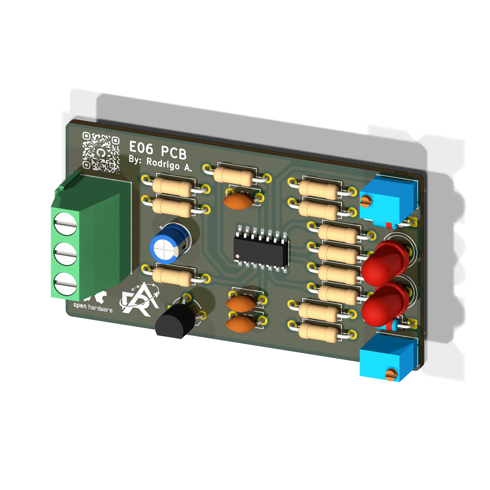

  

<h1 align="center">E06 Project - Analog Temperature Monitor</h1>

    
    
    
    
    

 

    

## Overview

This project involves the development of an Analog Temperature Threshold Monitor tailored for the E06 (Analog Electronics 3) course at Inatel. The system senses temperature with an LM35 precision sensor (10 mV/°C). Its signal is conditioned by an LM324 operational amplifier in a non-inverting configuration with a gain of 10, which scales the output to 100 mV/°C. Two LM324 comparators with positive feedback (Schmitt trigger) classify the temperature into three bands: a green LED indicates T < 35 °C, a red LED indicates T > 58 °C, and both stay off in the normal range. Hysteresis of about 1 °C on each comparator eliminates output chattering caused by sensor noise near the thresholds. The green channel uses the inverting topology, and the red channel uses the non-inverting topology. Each threshold can be calibrated through Bourns 3362 trimpots, with series resistors that limit the adjustment range to ±10% for fine tuning. The hardware design runs on a symmetric ±15 V supply. It includes 1N4148 diodes that protect the LEDs against reverse voltage, an RC damper on the sensor output and local decoupling capacitors.

## Repository Organization

* `docs`: Project documentation.
* `hardware`: Native KiCad project and manufacturing files.
* `mechanics`: 3D models, technical drawings, and physical integration constraints.

## Releases

<table>
  <thead>
    <tr>
      <th>Render</th>
      <th>Hardware Revision</th>
      <th>Status</th>
      <th>Latest Release</th>
      <th>Date</th>
      <th>Datasheet</th>
      <th>BOM</th>
      <th>Manufacturing Info</th>
    </tr>
  </thead>
  <tbody>
    <tr>
      <td></td>
      <td>v1</td>
      <td>🚧 Development</td>
      <td><a href="#">-</a></td>
      <td>11-11-2026</td>
      <td><a href="#">-</a></td>
      <td><a href="#">-</a></td>
      <td><a href="#">-</a></td>
    </tr>
  </tbody>
</table>

## Fabrication

This board is intended to be fabricated using a chemical etching process. Both F.Cu and B.Cu layers are available in the [fabrication](hardware/fabrication/) folder.

## Contributing

We welcome contributions to this project! To ensure a smooth collaboration and maintain our engineering standards, please review our [Contribution Guidelines](CONTRIBUTING.md) before opening any issues, modifying the hardware design, or submitting pull requests.

## References

## License

The hardware designs and schematics are licensed under the permissive **[CERN-OHL-P-2.0](hardware/LICENSE)** open-hardware license. You are entirely free to use, modify, distribute, and commercialize the design without any copyleft obligations to share your derived works under the same terms.

---

 

  

📜 This project is part of <strong><a href="https://github.com/Rorchive">Rorchive</a></strong>, my personal archive of activities and courses developed during my undergraduate studies at <strong>Inatel</strong>.

  Built with ❤️ by <a href="https://github.com/RodrigoCAndrade">Rodrigo Andrade</a>

